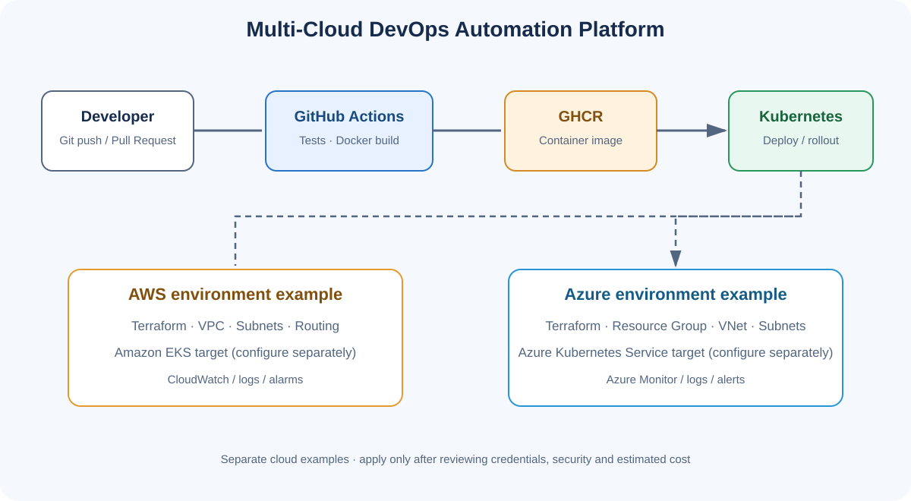

# Multi-Cloud DevOps Automation Platform


A practical portfolio lab demonstrating an application delivery workflow that can be used with AWS or Azure infrastructure.

> **Honest project status:** This repository contains runnable application code, automated CI checks, container build instructions, Kubernetes manifests, Terraform examples, an architecture diagram and interview/runbook documentation. Cloud provisioning and cluster deployment must be performed in your own account; do not describe them as live production deployments until you have run and captured evidence.

## Architecture



The pipeline validates source code, runs tests, builds a Docker image and publishes it to GitHub Container Registry when changes are pushed to the default branch. The image can then be deployed to a Kubernetes cluster on Amazon EKS or Azure Kubernetes Service (AKS). Terraform examples are kept separate for AWS and Azure so each cloud can be reviewed and applied independently.

## What is included

| Component | Implementation |
|---|---|
| Demo application | Python Flask health API |
| Automated checks | GitHub Actions, pytest, Terraform format/validation |
| Container | Docker multi-stage-ready slim Python image |
| Orchestration | Kubernetes Deployment and Service manifests |
| AWS example | Terraform VPC, public/private subnets and routing |
| Azure example | Terraform resource group, VNet and subnets |
| Operations | Health endpoint, runbook and troubleshooting guide |
| Interview prep | Architecture explanation and scenario questions |

## Repository layout

```text
.
├── app/                    # Flask demo service and tests
├── k8s/                    # Kubernetes Deployment and Service
├── terraform/
│   ├── aws/                # AWS network foundation example
│   └── azure/              # Azure network foundation example
├── docs/
│   ├── architecture.svg    # Architecture image
│   ├── interview-guide.md  # Interview explanation and questions
│   └── runbook.md          # Build, deploy, verify and troubleshoot
├── .github/workflows/ci.yml
├── Dockerfile
└── requirements.txt
```

## Run locally

Requirements: Python 3.11+ and Docker (optional for container testing).

```bash
python -m venv .venv
source .venv/bin/activate        # Windows: .venv\Scripts\activate
pip install -r requirements.txt
python app/app.py
```

Open `http://localhost:8080/health`. Expected response:

```json
{"status":"healthy","service":"cloud-ops-demo"}
```

Run tests:

```bash
pip install pytest
pytest -q
```

Build and run the container:

```bash
docker build -t cloud-ops-demo:local .
docker run --rm -p 8080:8080 cloud-ops-demo:local
```

## Kubernetes deployment

After building and pushing an image to a registry accessible by your cluster, update the image in `k8s/deployment.yaml`, then run:

```bash
kubectl apply -f k8s/
kubectl rollout status deployment/cloud-ops-demo
kubectl get pods,svc
kubectl port-forward svc/cloud-ops-demo 8080:80
```

Verify at `http://localhost:8080/health`. For a public service, add an ingress/load balancer only after reviewing your cloud costs and security rules.

## Terraform examples

AWS and Azure examples are intentionally independent:

```bash
cd terraform/aws   # or terraform/azure
terraform init
terraform fmt -check
terraform validate
terraform plan
```

Review the plan and configure required provider authentication before applying. These examples create billable cloud resources. Never commit credentials, state files or real `.tfvars` secrets. Run `terraform destroy` when the lab is no longer needed.

## CI/CD workflow

The GitHub Actions workflow runs application tests, builds the Docker image, and validates Terraform formatting/configuration. On pushes to the default branch it can publish the image to GitHub Container Registry (GHCR). It does **not** automatically provision cloud resources or deploy to a cluster; those steps require explicit environment credentials and configuration.

## Security checklist

- Use least-privilege IAM roles or Azure managed identities.
- Store credentials in GitHub Actions Secrets or a cloud secret manager; never in source files.
- Pin and review third-party GitHub Actions before production use.
- Restrict Kubernetes RBAC and network access.
- Scan images and dependencies before production use.
- Keep Terraform state in a secured remote backend for team use.
- Review cloud cost estimates before applying Terraform.

## Interview preparation and evidence

See [Interview Guide](docs/interview-guide.md) and [Operations Runbook](docs/runbook.md). Add your own screenshots of successful workflow runs, Docker output, Kubernetes resources and cloud resources after you execute the steps. Redact account IDs, IPs, tokens and other sensitive details.

## Author

**Nishant Girase** · [GitHub Profile](https://github.com/Nishant9022)
