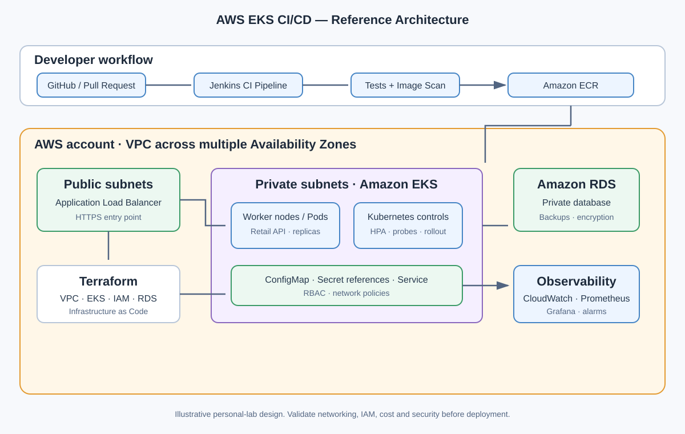

# AWS EKS CI/CD Platform — Production-Style Portfolio Lab

A realistic DevOps portfolio project for a fictional online retail API. It models an engineering workflow using AWS infrastructure, Terraform, Jenkins, Docker, Amazon ECR, Amazon EKS, Kubernetes health checks, autoscaling, monitoring and release rollback.

> Portfolio disclosure: this is a self-built learning project, not a project delivered for Nexora Technologies or another employer. Run the deployment in your own AWS account and add genuine evidence before claiming it is deployed or production-tested.

## Business scenario
A retail engineering team needs repeatable releases for a containerized API. Code changes pass CI tests and security checks, build a versioned Docker image, publish it to ECR and deploy to EKS. An Application Load Balancer provides ingress. RDS is the managed database target. CloudWatch and Prometheus/Grafana support operations.

## Architecture

## Technology stack
- AWS: VPC, public/private subnets, IAM, ECR, EKS, ALB, RDS, CloudWatch
- CI/CD: Jenkins declarative pipeline
- IaC: Terraform
- Containers: Docker
- Orchestration: Kubernetes Deployment, Service, HPA and probes
- Observability: CloudWatch, Prometheus and Grafana
- Scripting: Bash and Python

## Delivery workflow
1. Developer opens a feature branch and pull request.
2. Jenkins checks out source and runs unit tests.
3. Dependency and image scanning run before release.
4. Docker builds a versioned image and publishes it to ECR.
5. Kubernetes rolls out the new image to EKS.
6. Readiness and liveness probes validate the release.
7. Monitoring checks application health and cluster signals.
8. If verification fails, the operator rolls back to the previous ReplicaSet.

## Repository layout
- app/ — Flask API and tests
- docker/ — Dockerfile
- k8s/ — Deployment, Service, HPA and ConfigMap
- terraform/ — AWS infrastructure implementation plan
- docs/ — architecture image, interview guide and runbook
- Jenkinsfile — declarative pipeline example

## Run locally
Requirements: Python 3.11+ and Docker.

    cd aws-eks-cicd-platform
    python -m venv .venv
    source .venv/bin/activate
    pip install -r app/requirements.txt
    pytest -q app/tests
    python app/main.py

Open http://127.0.0.1:8080/health.

Build and run the container:

    docker build -f docker/Dockerfile -t retail-api:local .
    docker run --rm -p 8080:8080 retail-api:local

## Terraform and AWS
The Terraform directory documents the target architecture and safe implementation workflow. Configure least-privilege AWS credentials, review all resources and run terraform fmt, validate and plan before applying. EKS, NAT gateways and RDS can incur significant charges. Destroy lab resources when finished.

## Kubernetes
After creating EKS and publishing the image to ECR, replace the sample image reference in k8s/deployment.yaml.

    kubectl apply -f k8s/
    kubectl rollout status deployment/retail-api
    kubectl get pods,svc,hpa
    kubectl rollout history deployment/retail-api

Rollback:

    kubectl rollout undo deployment/retail-api
    kubectl rollout status deployment/retail-api

## Evidence checklist
Add your own screenshots after running the lab: Jenkins stages, ECR image, EKS nodes and healthy pods, HPA output, CloudWatch alarms, successful rollout and rollback. Redact account IDs, IPs and secrets. Never fabricate screenshots or claim a deployment ran if it has not.

## Interview preparation
See docs/interview-guide.md and docs/runbook.md.

## Resume-safe project description
AWS EKS CI/CD Automation Platform — Personal Portfolio Project. Designed a production-style AWS DevOps workflow using Terraform, Jenkins, Docker, Amazon ECR and Amazon EKS. Created Kubernetes manifests with health probes and autoscaling, documented release rollback procedures, and planned observability using CloudWatch and Prometheus/Grafana. Describe only components you have personally implemented and tested.
